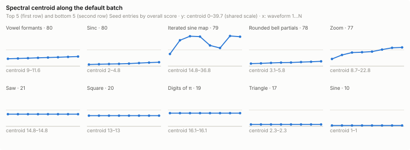
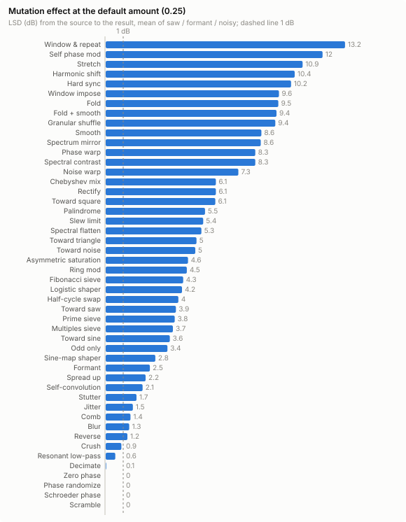

# Harmonic interest of the mkwavez generators

Generated by `npm run eval:harmonics` (scripts/harmonics/): 2281 batches of N = 8 waveforms (54 Seed entries × default + 8 random-parameter batches where the entry has anything to randomise, 48 mutations, 9 breed operators, 17 factory Shape chains, 9 grids), base seed 24301. Summary data: [harmonic-interest-data/](harmonic-interest-data/) (summary.json and one CSV per section, one row per item); the full per-batch dump is written locally to `.harmonics/`.

## Summary

- **Top by overall score:** *Vowel formants*, *Sinc*, *Iterated sine map*, *Digits of π* and *Logistic map*: pitched spectra that keep changing across the batch. **Bottom:** *Harmonics* (one sine per waveform, by design) and the four basic waves, which are a single waveform.
- **Every finding of the first run is resolved** (see *Fixes since first run* for the before / after numbers):
  - *Logistic map*, *Dynamical systems*, *Polygon*, *Superformula* and *Chebyshev* keep their fundamental: every waveform of their default batches has divisor 1 and h1 above −40 dB (they were 2–6.5 and −64 … −120 dB). The app also badges any shown waveform that sounds above its note ("sounds +1 oct").
  - *Superformula*'s default batch has no silent waveform; *Digits of π* gives 8 different waveforms (it was 8 copies); *Spline*'s default batch travels 23 dB (5).
  - *Reverse* never goes silent, *Hard sync* chains stay audible, and *Decimate* / *Resonant low-pass* act at the default amount (4–6 dB on a saw at 0.25, from ≤ 0.8).
  - Breed's default bias with three parents sits between B and C instead of on B, and Generation batches differ for every operator (unseeded operators: 54–70, from 20–25).
- **Still pitch-shifted by design** (the badge flags them): *Gray code* and *Euclidean pulses* (masks and pulse counts that repeat within the cycle), *Harmonics* (sin((n+1)p)), and Polygon's Trace of a star (the pen goes round k times). *CZ resonance (sine window)* has a weak fundamental (−57 dB) at high ratios.
- **Coherent sweeps vs random walks.** Noise and automaton generators change every waveform but wander: path ≈ 45–55 dB, net ≈ 4–8 dB. The motion term credits net displacement, so coherent sweeps have closed most of the gap: *Sync sweep* scores 72 and *Schroeder phases*, *Primes* and *Nested FM* about 67, against 68–75 for the noise generators.
- **What this evaluation can't see:** four phase mutations, *Reverse* (now a phase morph: reversing a waveform never changes its magnitudes), *Magnitudes from A* and the *Phase scatter* chain leave the harmonic magnitudes alone. That is by design, so they score as duplicates here.

## Fixes since first run

The first run of this report (main 2821b1b) found the problems below; each is fixed on this branch. *Before* numbers are from that run, *after* from this one (same configuration). Stored recipes still re-render exactly as they were made: retuned Seed defaults only change new batches, new Seed params declare the value that reproduces the old output, and changed mutations are versioned (mutation revision 2; recipes and Shape steps without a revision use the old behaviour).

| Finding | Fix | Before | After |
| --- | --- | --- | --- |
| *Logistic map* sounds an octave up (symmetric about ½) | asymmetric start 0.5 + 0.4·(sin p + 0.2 sin 2p)/1.1 | h1 −120 dB, divisor 2, overall 59.7 (#38) | h1 −7 dB, divisor 1, overall 77.8 (#5) |
| *Dynamical systems* (logistic / sine / tent) an octave up | "Initial condition" param, asymmetric by default | h1 −120 dB, divisor 2, default 59.9 | h1 −10 dB, divisor 1, default 76.5 |
| *Polygon* radius read: only multiples of n | "Off-centre" reading point, 0.25 of the inner radius by default | h1 −113 dB, divisor 6.5, default 49.8 | h1 −0.3 dB, divisor 1, default 67.5 |
| *Superformula*: multiples of 6, first waveform silent | off-centre read (0.25); n2 = n3 sweep from 3 (2 is a circle) | silent waveform, h1 −120 dB, divisor 6, default 36.5 | none silent, h1 −3 dB, divisor 1, default 65.7 |
| *Chebyshev*: even orders give even harmonics only | sweeps odd orders 3…17 | h1 −64 dB, divisor 1.5, default 66.4 | h1 −11 dB, divisor 1, default 74.7 |
| *Digits of π*: 8 identical waveforms (n only rotated the digits) | a new 16-digit window per waveform: `seq(p, 0, 16, 0, 16*n)` | static, path 0 dB, 100% duplicates, 18.6 | path 57 dB, 0% duplicates, 77.9 |
| *Spline* default batch barely moves | default batch adds a point per waveform | travel 5.2 dB (path 6), default 44.2 | travel 23 dB (path 42), default 71.6 |
| *Reverse* no-op below 0.5, silent at 0.5 | phases morph toward the reversed cycle's, magnitudes kept | silent waveforms in 8 batches | none (now phase-only, by nature) |
| *Hard sync* chained at 1 silent from step 4 | read ratio capped so the lowest harmonic stays ≤ h36.5 | silent in 3 chain batches, chain score 57.7 | none, chain score 71.6 |
| *Decimate* near no-op at 0.25 | hold 2^(7·a^0.35) samples (same ends) | 0.1 / 0.0 / 0.1 dB at 0.25, score 28.7 | 4.6 / 1.6 / 4.2 dB, score 47.1 |
| *Resonant low-pass* near no-op at 0.25 | cutoff 1.5·96^(1−a) (h144 → h1.5) | 0.8 / 0.1 / 0.8 dB at 0.25, score 40.7 | 5.6 / 0.9 / 5.6 dB, score 54.3 |
| Breed, 3 parents at bias 0.5 = parent B: every child is B | default bias between two parents (¾ for three) | 100% duplicates, path 0 | Crossfade path 29 dB, Genetic 60 dB, 0% duplicates |
| Breed Generation: unseeded operators give 8 near-copies | children after the first nudge bias (and custom weights) | Gen scores 20–25 | Crossfade 60, Spectral mix 63, Phases from A 61, Envelope 54, Split 70 |

Effects are saw / formant / noisy at amount 0.25 (lin). Not changed in this round: *Crush* (about 1 dB on a saw at 0.25), listed with the weak mappings.

## Method

Every waveform is rendered by the app's own code — `seedTable()` for the Seed library (formula presets compiled by `src/browser/formulaEval.ts`, which is plain `new Function` and runs under Node unchanged), `mutateBatch()`, `breedBatch()`, `applyChain()` and `gridRowTable()` — so each one leaves through `shape()` (DC removed, band-limited to 72 harmonics, phase-aligned, peak-normalised) exactly as the app adds it. Seed entries get their default batch (default params, seed 24301) plus 8 batches with uniformly random params (on each slider's step grid; dropdowns uniformly) and a derived seed. Mutations, breeds and Shape chains run on reference waveforms (below). Metrics use the harmonic magnitudes 1…72 only.

**References.** *saw* = basicWave('saw'); *formant* = Seed 'vowel-formants', defaults, seed 1, waveform 5 of 8; *noisy* = Seed 'perlin-noise', defaults, seed 1, waveform 1 of 8; *sine* = basicWave('sine').

**Per-waveform metrics** (dB re the strongest harmonic):

| Metric | Definition |
| --- | --- |
| harmonics (sig) | number of harmonics above -60 dB; *highest* = the highest of them |
| centroid / spread | amplitude-weighted mean / standard deviation of the harmonic number |
| flatness | geometric / arithmetic mean of the 72 harmonic powers (1 = white, 0 = a single harmonic) |
| entropy | Shannon entropy of the normalised powers / ln 72 |
| slope | least-squares fit of the significant harmonics' dB against log2 k, dB/octave (saw −6.0, triangle −12.0) |
| odd/even | energy of odd harmonics ≥ 3 vs even harmonics (dB, ±60), and the even share of the energy above the fundamental |
| irregularity | noise-like fine structure: RMS difference between neighbouring significant harmonics after removing a quadratic trend in log2 k, /√2 (saw 0, random magnitudes ≈ 5–6 dB) |
| formants | peaks in the spectral envelope (±1-harmonic max filter, 3-tap mean) with topographic prominence ≥ 6 dB |
| h1 | fundamental level (dB) and energy share |
| divisor | greatest common divisor of the harmonics above -40 dB: 1 = pitched at the played note; g > 1 = every present harmonic is a multiple of g, so the waveform sounds g× higher (2 = an octave) |
| crest | peak / RMS of the cycle |

**Batch metrics** — distances are log-spectral distances (LSD): the RMS dB difference over the harmonics present (above -40 dB) in either waveform, each spectrum floored at -40 dB. *path* = sum of consecutive LSDs; *net* = min(LSD(first, last), path); *straightness* = net / path (1 = one direction, → 0 = back and forth or a random walk); *step CV* = coefficient of variation of the step sizes; *duplicates* = consecutive pairs with LSD < 0.5 dB (of which *phase-only* = the cycles still differ by > 5% RMS); *static* = every waveform within the duplicate threshold of the first; *silent* = an all-zero waveform; *centroid range / monotonic* = range and |Spearman ρ| of the centroid along the batch.

**Composite score** (0–100; scripts/harmonics/score.ts). A weighted geometric mean of six components in [0, 1], each floored at 0.05, times penalties:

```
score = 100 · exp(Σ wᵢ ln max(cᵢ, floor) / Σ wᵢ) · (1 − silentFrac) · (1 − dupPenalty · dupFrac)
richness   = ½ clamp(log2(sig) / log2(48)) + ½ clamp(entropy / 0.5)                        w = 1
balance    = (1 − clamp((flatness − 0.25) / 0.35)) · (1 − 0.5 clamp((irregularity − 2) / 4))  w = 0.75
pitch      = (0.5 + 0.5 clamp((h1 dB − (-40)) / 34)) / divisor                       w = 0.75
motion     = 1 − exp(−travel / 20 dB),  travel = net + 0.25 · (path − net)               w = 1
smoothness = 1 − ½ clamp(stepCV / 2)   (0.5 if path < 1 dB)                                     w = 0.25
structure  = (½ + ½ min(formants, 2) / 2) · balance                                              w = 0.25
dupPenalty = 0.5
```

*Motion* credits coherent sweeps: the net displacement from the first to the last waveform counts fully, the rest of the path (wandering back and forth, random walks) only by the wander fraction. *Pitch* keeps a waveform honest about the note it plays: a weak or missing fundamental costs up to half, and a common divisor g of the present harmonics (the waveform is really pitched g× higher) divides by g. Weights are adjustable (`--w.motion=1.5`, `--weights file.json`). Seed entries are ranked by *overall* = ½ default-batch score + ½ mean random-batch score (the default alone when there is nothing to randomise).

**Caveats.**
- The score is a sorting heuristic, not a measure of taste. It rewards dense, pitched spectra and batches that get somewhere, and punishes silence, duplicates, pure sines and flat or noise-jagged spectra. A static Sine is a perfectly good waveform; it just has nothing to evaluate here.
- **The Gray code lesson.** The first version of this report ranked *Gray code* first. Its waveforms have no fundamental at all (h1 ≈ −120 dB), and their harmonics share a common divisor (octave-shifted combs). Its "motion" came largely from faint harmonics appearing out of a −60 dB floor, each counted as a step of up to 60 dB. Three fixes followed:
  - distances now use a −40 dB floor;
  - the score has a *pitch* term (weak or missing fundamental, common divisor);
  - motion credits net displacement over wandering.

  Gray code now ranks mid-table.
- The evaluation sees magnitudes only. Phase-only changes, which matter once a waveform is waveshaped, count as duplicates.
- LSD counts a harmonic crossing the −40 dB floor as a step of up to 40 dB, so sparse spectra (a handful of harmonics, e.g. *Harmonics*, *Chebyshev*, *Rounded bell partials*) still move a lot per step.
- *Divisor* uses harmonics above −40 dB. A waveform whose fundamental sits at −50 dB is still counted as pitch-shifted, even though a careful listener may hear the low note.
- Random-parameter batches sample every slider uniformly, so they land in corners nobody would choose: very long Karplus-Strong decays, one-term fractals, frozen Life rules, resonance ratios of 20. Their mean measures how forgiving a parameter space is, not how good it is.
- The irregularity penalty also catches structured but jagged spectra (*Blancmange*: 10.8 dB), not only noise.
- Glyph contour uses a Node stand-in tracer (a stroke font), not system-ui. Its default text "mkwavez" has 7 characters, so waveform 8 repeats waveform 1 and its net displacement is 0.
- Shape chains that don't sweep make identical batches by design. The Shape chains section reports how much they change the source instead.

## Seed library ranking

| # | Entry | Category | Overall | Default | Random mean (min–max) | Sig | Centroid | Slope | h1 dB | Div | Irreg | Path / net dB | Dup | Default flags |
| ---: | --- | --- | ---: | ---: | ---: | ---: | ---: | ---: | ---: | ---: | ---: | ---: | ---: | --- |
| 1 | Vowel formants | Voice | 79.9 | 79.9 | – (nothing to randomise) | 40 | 10.3 | -10.6 | -23 | 1.0 | 4.7 | 68 / 28 | 0% |  |
| 2 | Sinc | Geometry | 79.6 | 79.6 | – (nothing to randomise) | 24 | 3.2 | -16.8 | -1 | 1.0 | 3.2 | 49 / 23 | 0% |  |
| 3 | Iterated sine map | Chaos | 78.8 | 78.8 | – (nothing to randomise) | 36 | 29.8 | -1.9 | -8 | 1.0 | 9.3 | 88 / 19 | 0% |  |
| 4 | Digits of π | Sequence | 77.9 | 77.9 | – (nothing to randomise) | 67 | 17.2 | -5.7 | -7 | 1.0 | 5.9 | 57 / 9 | 0% |  |
| 5 | Logistic map | Chaos | 77.8 | 77.8 | – (nothing to randomise) | 72 | 27.9 | -2.7 | -7 | 1.0 | 9.2 | 89 / 19 | 0% |  |
| 6 | Rounded bell partials | Spectral | 77.5 | 77.5 | – (nothing to randomise) | 4 | 4.4 | -3.3 | 0 | 1.0 | 0.0 | 175 / 29 | 0% |  |
| 7 | Zoom (Perlin noise) | Perlin | 77.4 | 80.2 | 74.7 (68–80) | 72 | 17.3 | -6.4 | -6 | 1.0 | 5.3 | 56 / 20 | 0% |  |
| 8 | Sine→saw | Math | 76.8 | 76.8 | – (nothing to randomise) | 63 | 12.2 | -6.0 | -1 | 1.0 | 0.4 | 34 / 13 | 0% |  |
| 9 | Roughen (Perlin noise) | Perlin | 75.6 | 76.1 | 75.0 (68–79) | 72 | 20.0 | -5.5 | -7 | 1.0 | 5.6 | 45 / 15 | 0% |  |
| 10 | Drift (Perlin noise) | Perlin | 75.3 | 75.1 | 75.5 (72–78) | 72 | 15.0 | -6.9 | -5 | 1.0 | 5.2 | 48 / 7 | 0% |  |
| 11 | Perlin noise | Noise & automata | 74.5 | 75.1 | 73.9 (71–77) | 72 | 15.0 | -6.9 | -5 | 1.0 | 5.2 | 48 / 7 | 0% |  |
| 12 | Pulse | Basic | 74.2 | 80.0 | 68.3 (61–80) | 70 | 15.3 | -6.0 | 0 | 1.0 | 4.8 | 57 / 16 | 0% |  |
| 13 | Gauss bumps | Geometry | 72.5 | 72.5 | – (nothing to randomise) | 16 | 3.6 | -13.0 | -1 | 1.0 | 3.4 | 34 / 11 | 0% |  |
| 14 | Sync sweep (Hard sync) | Math | 72.4 | 74.6 | 70.2 (57–75) | 54 | 7.4 | -7.3 | -25 | 1.4 | 1.3 | 48 / 40 | 0% |  |
| 15 | Add octaves (Perlin noise) | Perlin | 71.9 | 71.1 | 72.7 (60–77) | 66 | 14.5 | -8.2 | -2 | 1.0 | 4.9 | 32 / 16 | 14% |  |
| 16 | Euclidean pulses | Sequence | 71.6 | 71.6 | – (nothing to randomise) | 44 | 19.5 | -5.5 | -71 | 2.5 | 4.9 | 112 / 18 | 0% | no-fundamental, pitch-shifted |
| 17 | Reaction-diffusion ring | Simulations | 71.5 | 74.7 | 68.3 (55–75) | 55 | 9.1 | -11.4 | -11 | 1.0 | 5.3 | 53 / 8 | 0% |  |
| 18 | Additive designer | Builders | 71.1 | 75.8 | 66.4 (54–82) | 72 | 9.6 | -8.7 | 0 | 1.0 | 0.9 | 21 / 10 | 0% |  |
| 19 | Supersaw | Basic | 70.8 | 74.5 | 67.2 (58–75) | 72 | 15.4 | -5.9 | -1 | 1.0 | 5.2 | 61 / 9 | 0% |  |
| 20 | CZ resonance (saw window) (Resonance) | Voice | 70.4 | 78.9 | 61.9 (36–79) | 62 | 8.6 | -10.5 | -18 | 1.0 | 1.7 | 40 / 16 | 0% |  |
| 21 | Dynamical systems | Simulations | 69.7 | 76.5 | 62.8 (42–77) | 72 | 28.9 | -2.0 | -10 | 1.0 | 8.9 | 81 / 19 | 0% |  |
| 22 | Number sequences | Builders | 69.4 | 72.1 | 66.8 (21–80) | 68 | 16.3 | -5.9 | -3 | 1.0 | 6.1 | 23 / 9 | 0% |  |
| 23 | Shaped PWM (Waveshaper) | Shapers | 68.5 | 66.0 | 71.1 (55–79) | 35 | 4.7 | -11.7 | 0 | 1.0 | 5.6 | 42 / 12 | 0% |  |
| 24 | Life-like automaton | Simulations | 68.2 | 76.0 | 60.4 (20–77) | 69 | 18.8 | -5.8 | -5 | 1.0 | 5.3 | 50 / 8 | 0% |  |
| 25 | Cellular automaton | Noise & automata | 67.8 | 73.1 | 62.6 (12–77) | 69 | 19.9 | -5.7 | -7 | 1.0 | 5.9 | 45 / 4 | 0% |  |
| 26 | Nested FM (FM / PM) | Phase | 67.3 | 68.9 | 65.7 (42–77) | 36 | 6.8 | -11.0 | -5 | 1.0 | 7.0 | 30 / 18 | 0% |  |
| 27 | Schroeder phases (Harmonic series) | Spectral | 67.2 | 80.0 | 54.4 (17–80) | 24 | 6.5 | -6.0 | 0 | 1.0 | 0.0 | 21 / 21 | 0% |  |
| 28 | Primes (Harmonic series) | Spectral | 67.0 | 76.9 | 57.1 (45–78) | 11 | 4.7 | -6.0 | 0 | 1.0 | 0.0 | 20 / 19 | 0% |  |
| 29 | FM sweep (FM / PM) | Math | 65.8 | 63.5 | 68.1 (53–78) | 6 | 3.3 | -11.2 | -4 | 1.0 | 4.6 | 54 / 26 | 0% |  |
| 30 | Chebyshev (Waveshaper) | Shapers | 65.5 | 74.7 | 56.4 (34–75) | 6 | 7.0 | 2.8 | -11 | 1.0 | 2.7 | 130 / 27 | 0% |  |
| 31 | Fibonacci (Harmonic series) | Spectral | 64.8 | 69.8 | 59.9 (36–74) | 9 | 5.6 | -4.5 | 0 | 1.0 | 0.0 | 11 / 11 | 0% |  |
| 32 | CZ resonance (sine window) (Resonance) | Voice | 64.4 | 65.0 | 63.8 (37–79) | 10 | 7.0 | 1.3 | -57 | 1.0 | 6.4 | 139 / 36 | 0% | no-fundamental |
| 33 | Pluck position (Harmonic series) | Spectral | 64.3 | 70.1 | 58.5 (20–71) | 29 | 2.8 | -11.5 | 0 | 1.0 | 3.5 | 47 / 16 | 0% |  |
| 34 | Superellipse (Waveshaper) | Shapers | 64.3 | 65.9 | 62.6 (17–79) | 25 | 5.1 | -9.3 | 0 | 1.0 | 0.2 | 28 / 11 | 0% |  |
| 35 | Superformula (Superformula) | Shapers | 63.9 | 65.7 | 62.2 (45–74) | 33 | 6.7 | -10.0 | -3 | 1.0 | 7.6 | 23 / 14 | 0% |  |
| 36 | Glyph contour | Builders | 63.8 | 66.1 | 61.5 (25–70) | 72 | 14.7 | -5.9 | -25 | 1.0 | 6.9 | 66 / 0 | 0% |  |
| 37 | Noisy FM | Perlin | 63.8 | 61.8 | 65.9 (62–67) | 39 | 4.8 | -8.8 | 0 | 1.0 | 4.9 | 31 / 12 | 0% |  |
| 38 | Gray code | Bits | 63.6 | 63.6 | – (nothing to randomise) | 24 | 16.3 | -6.0 | -120 | 2.3 | 0.0 | 67 / 16 | 0% | no-fundamental, pitch-shifted |
| 39 | Bytebeat | Bits | 63.4 | 63.4 | – (nothing to randomise) | 72 | 28.1 | -2.7 | -8 | 1.0 | 5.2 | 49 / 7 | 0% |  |
| 40 | Cross PM (FM / PM) | Phase | 62.8 | 61.2 | 64.3 (44–79) | 7 | 2.6 | -12.6 | 0 | 1.0 | 5.2 | 40 / 24 | 0% |  |
| 41 | Weierstrass (Fractal sum) | Fractal | 61.0 | 74.7 | 47.2 (10–75) | 7 | 5.9 | -4.7 | 0 | 1.0 | 0.0 | 21 / 20 | 0% |  |
| 42 | Blancmange (Fractal sum) | Fractal | 59.5 | 64.0 | 55.1 (30–76) | 44 | 6.1 | -9.5 | 0 | 1.0 | 10.8 | 13 / 12 | 0% |  |
| 43 | Sine + noise | Perlin | 59.2 | 61.1 | 57.4 (52–61) | 59 | 8.6 | -6.2 | 0 | 1.0 | 3.9 | 17 / 10 | 0% |  |
| 44 | CZ phase dist (Phase distortion) | Phase | 58.9 | 69.1 | 48.8 (41–69) | 27 | 3.2 | -12.8 | 0 | 1.0 | 3.6 | 53 / 17 | 0% |  |
| 45 | Spline | Builders | 57.4 | 71.6 | 43.2 (18–75) | 19 | 3.5 | -14.9 | -7 | 1.0 | 5.5 | 42 / 17 | 0% |  |
| 46 | Soft clip (Waveshaper) | Shapers | 57.4 | 60.9 | 53.8 (25–79) | 8 | 2.0 | -14.7 | 0 | 1.0 | 0.9 | 22 / 13 | 0% |  |
| 47 | Karplus-Strong snapshots | Simulations | 56.1 | 74.0 | 38.3 (14–74) | 25 | 8.8 | -11.7 | -7 | 1.0 | 9.2 | 77 / 28 | 0% |  |
| 48 | Polygon | Geometry | 55.8 | 67.5 | 44.1 (13–70) | 53 | 6.0 | -8.7 | -0 | 1.0 | 5.9 | 47 / 15 | 0% |  |
| 49 | Blank formula | Custom | 51.8 | 51.8 | – (nothing to randomise) | 2 | 1.2 | – | 0 | 1.0 | 0.0 | 24 / 24 | 0% |  |
| 50 | Harmonics | Math | 35.1 | 35.1 | – (nothing to randomise) | 1 | 4.5 | – | -105 | 4.5 | 0.0 | 280 / 40 | 0% | sine-like, no-fundamental, pitch-shifted |
| 51 | Saw | Basic | 20.9 | 20.9 | – (nothing to randomise) | 72 | 14.8 | -6.0 | 0 | 1.0 | 0.0 | 0 / 0 | 100% | static |
| 52 | Square | Basic | 19.5 | 19.5 | – (nothing to randomise) | 36 | 13.0 | -6.0 | 0 | 1.0 | 0.0 | 0 / 0 | 100% | static |
| 53 | Triangle | Basic | 17.0 | 17.0 | – (nothing to randomise) | 16 | 2.3 | -12.0 | 0 | 1.0 | 0.0 | 0 / 0 | 100% | static |
| 54 | Sine | Basic | 10.3 | 10.3 | – (nothing to randomise) | 1 | 1.0 | – | 0 | 1.0 | 0.0 | 0 / 0 | 100% | static, sine-like |

Sig, centroid, slope, h1, divisor, irregularity: means over the default batch; path / net and duplicates: the default batch.

## Highlights

**Most interesting (overall):** Vowel formants (80), Sinc (80), Iterated sine map (79), Digits of π (78), Logistic map (78).

**Least interesting:** Harmonics (35), Saw (21), Square (20), Triangle (17), Sine (10).



**Best coherent sweeps** (default batches with straightness ≥ 0.5, by net displacement first → last): Sync sweep (Hard sync) (travel 42 dB, net 40, straightness 0.84, centroid 1.0→4.0); Cross PM (FM / PM) (travel 28 dB, net 24, straightness 0.60, centroid 1.0→4.2); Blank formula (travel 24 dB, net 24, straightness 1.00, centroid 1.0→1.3); Schroeder phases (Harmonic series) (travel 21 dB, net 21, straightness 1.00, centroid 9.6→3.8); Weierstrass (Fractal sum) (travel 20 dB, net 20, straightness 0.96, centroid 2.4→10.9); Primes (Harmonic series) (travel 19 dB, net 19, straightness 0.99, centroid 2.6→7.6); Nested FM (FM / PM) (travel 21 dB, net 18, straightness 0.62, centroid 3.4→10.3); Superformula (Superformula) (travel 16 dB, net 14, straightness 0.62, centroid 3.5→9.4).

**Random walks** (default path > 20 dB, straightness < 0.25): Iterated sine map (path 88, net 19), Digits of π (path 57, net 9), Logistic map (path 89, net 19), Rounded bell partials (path 175, net 29), Drift (Perlin noise) (path 48, net 7), Perlin noise (path 48, net 7), Euclidean pulses (path 112, net 18), Reaction-diffusion ring (path 53, net 8), Supersaw (path 61, net 9), Dynamical systems (path 81, net 19), Life-like automaton (path 50, net 8), Cellular automaton (path 45, net 4), Chebyshev (Waveshaper) (path 130, net 27), Glyph contour (path 66, net 0), Gray code (path 67, net 16), Bytebeat (path 49, net 7), Harmonics (path 280, net 40).

**Missing fundamental or pitch-shifted** (default batch): Euclidean pulses (h1 -71 dB, divisor 2.5), CZ resonance (sine window) (Resonance) (h1 -57 dB, divisor 1.0), Gray code (h1 -120 dB, divisor 2.3), Harmonics (h1 -105 dB, divisor 4.5).

**Parameter spaces with many dead corners** (default − random mean > 15): CZ resonance (saw window) (Resonance) (79 vs 62; worst 36), Life-like automaton (76 vs 60; worst 20), Schroeder phases (Harmonic series) (80 vs 54; worst 17), Primes (Harmonic series) (77 vs 57; worst 45), Chebyshev (Waveshaper) (75 vs 56; worst 34), Weierstrass (Fractal sum) (75 vs 47; worst 10), CZ phase dist (Phase distortion) (69 vs 49; worst 41), Spline (72 vs 43; worst 18), Karplus-Strong snapshots (74 vs 38; worst 14), Polygon (68 vs 44; worst 13).

### Problem cases (Seed)

Flags: *silent* (an all-zero waveform), *static* (all waveforms ≈ the first), *duplicates* (≥ 50% consecutive near-duplicates), *phase-only*, *flat* (mean flatness > 0.5), *sine-like* (mean ≤ 1.5 significant harmonics), *no-fundamental* (mean h1 < −40 dB), *pitch-shifted* (mean divisor ≥ 1.5), *error*. Settings reproduce the batch (N = 8).

| Entry | Batch | Flags | Score | Settings |
| --- | --- | --- | ---: | --- |
| Sync sweep (Hard sync) | random-4 | pitch-shifted | 72 | seed 994486278 · wave=3 ratio=1.12 ratioEnd=9.65 |
| Sync sweep (Hard sync) | random-6 | pitch-shifted | 71 | seed 1923676206 · wave=1 ratio=9.43 ratioEnd=3.77 |
| Euclidean pulses | default | no-fundamental, pitch-shifted | 72 | seed 24301 |
| CZ resonance (saw window) (Resonance) | random-1 | no-fundamental | 62 | seed 2752703464 · window=2 ratio=6.85 ratioEnd=18.6 |
| CZ resonance (saw window) (Resonance) | random-2 | no-fundamental | 62 | seed 3698057941 · window=2 ratio=23.05 ratioEnd=14.5 |
| CZ resonance (saw window) (Resonance) | random-3 | no-fundamental | 36 | seed 2999168140 · window=0 ratio=22.05 ratioEnd=21.8 |
| CZ resonance (saw window) (Resonance) | random-7 | no-fundamental | 60 | seed 823252420 · window=3 ratio=13.2 ratioEnd=6.4 |
| CZ resonance (saw window) (Resonance) | random-8 | no-fundamental | 62 | seed 3101380852 · window=0 ratio=22.6 ratioEnd=2.1 |
| Dynamical systems | random-3 | flat | 57 | seed 3112759927 · map=2 control=0.6 controlEnd=0.925 iterations=18 spread=0.38 start=1 output=1 |
| Dynamical systems | random-5 | flat | 42 | seed 1852272357 · map=2 control=0.985 controlEnd=0.955 iterations=8 spread=0.4 start=1 output=1 |
| Dynamical systems | random-7 | no-fundamental, pitch-shifted | 55 | seed 2752452286 · map=4 control=0.2 controlEnd=0.41 iterations=27 spread=0.28 start=0 output=0 |
| Number sequences | random-3 | static | 21 | seed 3668205373 · source=0 steps=38 smoothing=0.38 offset=170 advance=0 pulses=56 |
| Life-like automaton | random-3 | static | 20 | seed 2068564974 · rule=4 read=1 size=30 density=0.41 start=126 step=2 |
| Life-like automaton | random-5 | static | 20 | seed 3676874801 · rule=4 read=1 size=39 density=0.65 start=25 step=13 |
| Cellular automaton | random-1 | no-fundamental, pitch-shifted | 58 | seed 2021288927 · rule=150 cells=48 start=39 |
| Cellular automaton | random-3 | static, no-fundamental, pitch-shifted | 12 | seed 2978067966 · rule=184 cells=44 start=41 |
| Cellular automaton | random-6 | no-fundamental, pitch-shifted | 69 | seed 1759755802 · rule=90 cells=64 start=27 |
| Cellular automaton | random-7 | no-fundamental, pitch-shifted | 59 | seed 1331037552 · rule=150 cells=48 start=30 |
| Nested FM (FM / PM) | random-1 | no-fundamental | 63 | seed 1381430209 · carrier=5 ratio=7 index=8.6 indexEnd=6.15 ratio2=7 amount2=1.9 routing=1 |
| Nested FM (FM / PM) | random-2 | flat | 42 | seed 3629144190 · carrier=2 ratio=5 index=7.15 indexEnd=2.35 ratio2=6 amount2=3.25 routing=1 |
| Nested FM (FM / PM) | random-5 | no-fundamental, pitch-shifted | 55 | seed 3367378522 · carrier=2 ratio=4 index=10.1 indexEnd=8.55 ratio2=8 amount2=0.9 routing=0 |
| Schroeder phases (Harmonic series) | random-7 | static | 17 | seed 2754773298 · set=2 highest=3 rolloff=0.1 rolloffEnd=0.1 phases=0 pluck=0.43 pluckEnd=0.43 |
| FM sweep (FM / PM) | random-5 | no-fundamental, pitch-shifted | 53 | seed 679985985 · carrier=6 ratio=4 index=6.85 indexEnd=5.95 ratio2=4 amount2=1.15 routing=2 |
| FM sweep (FM / PM) | random-6 | no-fundamental, pitch-shifted | 53 | seed 4128854811 · carrier=6 ratio=3 index=4 indexEnd=1.3 ratio2=6 amount2=0.55 routing=0 |
| Chebyshev (Waveshaper) | random-1 | duplicates | 38 | seed 439722024 · shaper=3 input=0 level=0.38 amount=0.3 amountEnd=3.9 bias=-0.37 biasEnd=0.36 |
| Chebyshev (Waveshaper) | random-8 | duplicates | 34 | seed 3786062818 · shaper=3 input=1 level=0.13 amount=9 amountEnd=3.3 bias=0.84 biasEnd=-0.07 |
| CZ resonance (sine window) (Resonance) | default | no-fundamental | 65 | seed 24301 · window=0 ratio=2 ratioEnd=12 |
| CZ resonance (sine window) (Resonance) | random-3 | no-fundamental | 61 | seed 2066620119 · window=0 ratio=20.05 ratioEnd=6.7 |
| CZ resonance (sine window) (Resonance) | random-7 | no-fundamental | 36 | seed 2339618493 · window=0 ratio=6.6 ratioEnd=6.4 |
| Pluck position (Harmonic series) | random-1 | duplicates | 20 | seed 273591309 · set=0 highest=65 rolloff=2.75 rolloffEnd=2.8 phases=0 pluck=0.35 pluckEnd=0.31 |
| Superellipse (Waveshaper) | random-1 | static | 17 | seed 1586240920 · shaper=3 input=1 level=0.33 amount=3.75 amountEnd=19.9 bias=-0.62 biasEnd=-0.73 |
| Glyph contour | random-2 | duplicates, phase-only | 25 | seed 1781385421 · batch=2 weight=600 weightEnd=400 skew=0.11 skewEnd=-0.01 |
| Gray code | default | no-fundamental, pitch-shifted | 64 | seed 24301 |
| Cross PM (FM / PM) | random-6 | no-fundamental, pitch-shifted | 55 | seed 1868414969 · carrier=4 ratio=2 index=6.35 indexEnd=8.1 ratio2=4 amount2=1.85 routing=1 |
| Cross PM (FM / PM) | random-7 | no-fundamental, pitch-shifted | 44 | seed 913088485 · carrier=6 ratio=6 index=4.8 indexEnd=4.3 ratio2=6 amount2=1.55 routing=2 |
| Cross PM (FM / PM) | random-8 | no-fundamental, pitch-shifted | 52 | seed 989489313 · carrier=4 ratio=6 index=9.55 indexEnd=11.75 ratio2=6 amount2=1.5 routing=1 |
| Weierstrass (Fractal sum) | random-4 | static | 20 | seed 1154678073 · base=3 ratio=2 terms=1 decay=0.23 decayEnd=0.44 |
| Weierstrass (Fractal sum) | random-6 | static, sine-like | 10 | seed 3747501643 · base=0 ratio=4 terms=1 decay=0.57 decayEnd=0.55 |
| Blancmange (Fractal sum) | random-4 | duplicates | 30 | seed 1986437795 · base=2 ratio=2 terms=3 decay=0.42 decayEnd=0.31 |
| Spline | random-3 | duplicates, phase-only | 25 | seed 3999741796 · points=11 kind=1 tension=0.87 jitter=0.43 jitterEnd=0.76 batch=0 |
| Spline | random-6 | duplicates | 18 | seed 4192288585 · points=6 kind=0 tension=0.36 jitter=0.17 jitterEnd=0.6 batch=0 |
| Spline | random-7 | duplicates, phase-only | 22 | seed 2185194757 · points=27 kind=1 tension=0.24 jitter=0.23 jitterEnd=0.41 batch=0 |
| Spline | random-8 | duplicates, phase-only | 23 | seed 4073807177 · points=29 kind=1 tension=0.61 jitter=0.33 jitterEnd=0.41 batch=0 |
| Soft clip (Waveshaper) | random-1 | duplicates, phase-only | 25 | seed 2145419743 · shaper=0 input=2 level=0.16 amount=8.25 amountEnd=1.2 bias=-0.11 biasEnd=-0.71 |
| Soft clip (Waveshaper) | random-3 | duplicates | 39 | seed 4197868802 · shaper=3 input=1 level=0.1 amount=8.3 amountEnd=8.8 bias=-0.71 biasEnd=0.4 |
| Soft clip (Waveshaper) | random-4 | duplicates | 45 | seed 3529958339 · shaper=3 input=2 level=0.34 amount=3.35 amountEnd=16.75 bias=0.63 biasEnd=0.85 |
| Karplus-Strong snapshots | random-2 | duplicates | 18 | seed 2554826691 · excite=1 length=103 damping=0.36 start=2032 end=1675 position=0.1 |
| Karplus-Strong snapshots | random-3 | duplicates | 43 | seed 2824866087 · excite=1 length=391 damping=0.6 start=1139 end=282 position=0.03 |
| Karplus-Strong snapshots | random-6 | duplicates | 39 | seed 1091873186 · excite=0 length=160 damping=0.73 start=1317 end=910 position=0.08 |
| Karplus-Strong snapshots | random-7 | duplicates | 14 | seed 1798279962 · excite=1 length=303 damping=0.65 start=583 end=494 position=0.41 |
| Karplus-Strong snapshots | random-8 | duplicates | 36 | seed 3109249447 · excite=1 length=135 damping=0.28 start=3175 end=980 position=0.06 |
| Polygon | random-2 | no-fundamental | 64 | seed 97699311 · read=1 offset=0.88 sides=3 star=2 roundness=0.76 rotation=0.36 batch=0 roundnessEnd=0.14 rotationEnd=0.64 |
| Polygon | random-4 | static, phase-only | 13 | seed 951575518 · read=1 offset=0.8 sides=3 star=2 roundness=0.68 rotation=0.94 batch=2 roundnessEnd=0.12 rotationEnd=0.07 |
| Polygon | random-6 | static | 19 | seed 2207502249 · read=0 offset=0.19 sides=13 star=7 roundness=0.58 rotation=0.38 batch=1 roundnessEnd=0.58 rotationEnd=0.54 |
| Polygon | random-7 | static, no-fundamental | 15 | seed 659999576 · read=1 offset=0.56 sides=9 star=4 roundness=0.43 rotation=0.2 batch=1 roundnessEnd=0.43 rotationEnd=0.16 |
| Harmonics | default | sine-like, no-fundamental, pitch-shifted | 35 | seed 24301 |

Not listed: the four basic waves (Sine, Triangle, Saw, Square), which are a single waveform by design.

## Observations by category

### Seed modes and formula presets

- **Formula presets vs parameter modes.** Overall, formula presets average 68.6 and generator / parameter-mode entries 61.6. The generator figure is pulled down by the four static basic waves and by the dead corners in the random batches. On default batches alone, without the basic waves, generator entries average 71.7.
- **Pitch.** The retuned entries keep their fundamental by default; the original readings stay one setting away (Polygon / Superformula Off-centre 0, Dynamical systems' symmetric start) and are badged in the app. Random batches still land on pitch-shifted settings now and then: Dynamical systems with the symmetric start, Polygon traced as a star (the pen goes round k times per cycle).
- **Random walks.** The noise and automaton generators (Perlin, cellular automaton, Life, reaction-diffusion, Supersaw, Bytebeat) change their whole fine structure on every waveform (mean step ≈ 6–9 dB), but straightness is only 0.1–0.16 and the centroid stays roughly flat. They still score in the 60s–70s for density and constant change. *Digits of π* and *Logistic map* now join them (new digits / new chaos on every waveform).
- **Coherent sweeps** (straightness ≥ 0.8): *Sync sweep*, *Schroeder phases*, *Primes*, *Fibonacci*, *Weierstrass*, *Blancmange*. Apart from *Sync sweep* (40 dB net), these travel only 10–21 dB, so a wider sweep would make them more useful (recommendations).
- **Static batches.** None among the defaults except the four basic waves (single waveforms by design). *Cellular automaton* rule 184 (a pure shift) is still static in random batches, for the reason Digits of π was: `shape()`'s phase alignment undoes a rotation.
- **Dead corners in random batches.**
  - *Karplus-Strong*: default 74, random mean 38. With the "Pluck shape" excitation, passes beyond about 500 are a sine.
  - *Polygon*: Trace reading of a convex polygon with many sides is a near-sine; sweeping roundness or rotation of some stars does little.
  - *Spline*: random batches that sweep the jitter (no longer the default batch) still barely move.
  - *Weierstrass* / *Blancmange* with terms = 1.
  - *Life*: the Maze rule freezes.
  - *Number sequences* with advance 0 (static by definition).
  - *Waveshaper* entries: hard clip with a low input level and a far-off bias saturates.
  - *CZ resonance*: high ratios leave the fundamental 40+ dB down.

| Category | Entries | Mean overall | Best | Worst |
| --- | ---: | ---: | --- | --- |
| Chaos | 2 | 78.3 | Iterated sine map (79) | Logistic map (78) |
| Sequence | 2 | 74.8 | Digits of π (78) | Euclidean pulses (72) |
| Voice | 3 | 71.6 | Vowel formants (80) | CZ resonance (sine window) (Resonance) (64) |
| Noise & automata | 2 | 71.2 | Perlin noise (75) | Cellular automaton (68) |
| Perlin | 6 | 70.5 | Zoom (Perlin noise) (77) | Sine + noise (59) |
| Geometry | 3 | 69.3 | Sinc (80) | Polygon (56) |
| Spectral | 5 | 68.2 | Rounded bell partials (78) | Pluck position (Harmonic series) (64) |
| Simulations | 4 | 66.4 | Reaction-diffusion ring (72) | Karplus-Strong snapshots (56) |
| Builders | 4 | 65.4 | Additive designer (71) | Spline (57) |
| Shapers | 5 | 63.9 | Shaped PWM (Waveshaper) (69) | Soft clip (Waveshaper) (57) |
| Bits | 2 | 63.5 | Gray code (64) | Bytebeat (63) |
| Phase | 3 | 63.0 | Nested FM (FM / PM) (67) | CZ phase dist (Phase distortion) (59) |
| Math | 4 | 62.5 | Sine→saw (77) | Harmonics (35) |
| Fractal | 2 | 60.3 | Weierstrass (Fractal sum) (61) | Blancmange (Fractal sum) (60) |
| Custom | 1 | 51.8 | Blank formula (52) | Blank formula (52) |
| Basic | 6 | 35.5 | Pulse (74) | Sine (10) |

Formula presets (15): mean overall 68.6, mean default 68.6; generator / parameter-mode entries (39): 61.6 overall; without the four basic waves, mean default 71.7.

### Mutate

- **Large effects at the default amount.** Spectral *Stretch*, *Window impose*, *Hard sync*, *Fold* / *Fold + smooth*, *Window & repeat*, *Harmonic shift* and *Smooth* change every reference by 5–18 dB at 0.25, and their sweeps are the best batches in this section.
- **Source-dependent mutations.** Many waveshapers (*Self phase mod*, *Noise warp*, *Phase warp*, *Chebyshev mix*, *Rectify*, *Logistic shaper*, *Ring mod*, *Palindrome*) change the formant wave by 9–25 dB but a saw by ≤ 1 dB at 0.25. A likely reason: smearing energy between neighbouring harmonics barely changes a dense, smooth 1/k spectrum in dB, while it fills the valleys of a formant spectrum.
- **Weak at 0.25.** *Decimate* and *Resonant low-pass* now act from small amounts (4.6 and 5.6 dB on a saw at 0.25). Still weak: *Crush* (28 levels at 0.25, about 1 dB), *Blur*, *Comb*, *Jitter* and *Spread up* (1–3 dB). In all, 21 of the 48 mutations change a saw by ≤ 2 dB at 0.25 (23 before).
- **Reverse is a phase morph.** Each harmonic's phase moves toward the reversed cycle's, magnitudes kept, so it is phase-only here (0.0 dB) and never silent. On a sine-phase waveform (saw, square, any sum of sines) the reversed cycle is the same sound; on others the waveform changes shape, which matters before a nonlinear step.
- **Chains.** *Hard sync* chained at amount 1 no longer collapses: the read ratio is capped so the source's lowest harmonic lands at most at h36.5, and the non-integer cap leaves a sync edge that brings the low harmonics back for the next step (chain score 72). *Toward sine*, *Smooth* and *Spectral contrast* chained at 1 collapse to ≤ 3 harmonics within a few steps, which is expected.
- **Phase-only by design.** *Zero phase*, *Schroeder phase*, *Phase randomize*, *Scramble* and *Reverse* leave every magnitude untouched (0.0 dB), and *Half-cycle swap* at amount 1 is −x(t+½), with the same magnitudes. These change the cycle's shape and matter before a nonlinear step, not on their own.
- **Lin vs log.** Lin batches generally score higher than log batches. Log crowds 7 of 8 waveforms into small amounts, which for most mutations means near-duplicates.

Each mutation × {saw, formant, noisy} × amounts {0.1, 0.25, 0.5, 1} × {lin, log, chain}, N = 8, one seed per mutation. *Effect* = LSD from the source to the batch's last waveform (= the amount itself for lin / log).

| Mutation | Group | Mean score | Effect @ 0.25 lin (saw / formant / noisy, dB) | Effect @ 1 (mean) | Score lin / log / chain | Dup | Notes |
| --- | --- | ---: | ---: | ---: | ---: | ---: | --- |
| Hard sync | Waveshape | 74.8 | 5.1 / 17.7 / 7.9 | 19.6 | 76 / 77 / 72 | 0% |  |
| Stretch | Spectral | 74.6 | 5.0 / 18.0 / 9.6 | 16.2 | 77 / 66 / 81 | 10% |  |
| Window impose | Time | 71.5 | 5.9 / 15.4 / 7.4 | 18.9 | 75 / 76 / 64 | 6% |  |
| Self phase mod | Waveshape | 68.4 | 0.6 / 24.6 / 10.7 | 12.8 | 68 / 67 / 70 | 3% |  |
| Phase warp | Waveshape | 65.1 | 0.9 / 17.6 / 6.3 | 12.2 | 62 / 57 / 76 | 15% |  |
| Fold | Waveshape | 64.9 | 7.6 / 14.8 / 6.2 | 14.3 | 67 / 59 / 69 | 11% |  |
| Fold + smooth | Waveshape | 64.7 | 8.1 / 13.2 / 7.0 | 15.8 | 66 / 59 / 70 | 11% |  |
| Noise warp | Waveshape | 64.6 | 1.0 / 15.1 / 5.9 | 10.4 | 64 / 58 / 72 | 12% |  |
| Harmonic shift | Spectral | 64.1 | 5.5 / 17.5 / 8.3 | 18.3 | 65 / 55 / 72 | 24% |  |
| Window & repeat | Time | 58.1 | 11.2 / 14.7 / 13.7 | 19.6 | 67 / 64 / 43 | 19% |  |
| Chebyshev mix | Nonlinear | 57.7 | 0.7 / 12.8 / 4.8 | 11.6 | 54 / 50 / 69 | 27% |  |
| Rectify | Waveshape | 57.5 | 0.8 / 13.5 / 4.0 | 13.2 | 55 / 49 / 68 | 29% |  |
| Slew limit | Time | 56.2 | 4.1 / 8.4 / 3.7 | 12.3 | 58 / 46 / 64 | 31% |  |
| Smooth | Spectral | 55.5 | 7.4 / 6.3 / 12.1 | 18.2 | 60 / 50 / 57 | 29% | chain @ 1 collapses to ≤ 3 harmonics |
| Spectrum mirror | Spectral | 55.5 | 5.0 / 13.8 / 6.9 | 19.4 | 59 / 59 / 48 | 31% |  |
| Toward noise | Morph | 55.4 | 3.0 / 8.8 / 3.1 | 9.3 | 52 / 46 / 69 | 27% |  |
| Palindrome | Time | 54.9 | 0.7 / 11.6 / 4.2 | 15.0 | 51 / 44 / 70 | 31% |  |
| Granular shuffle | Time | 54.9 | 7.1 / 12.8 / 8.2 | 10.6 | 51 / 43 / 71 | 44% |  |
| Resonant low-pass | Spectral | 54.3 | 5.6 / 0.9 / 5.6 | 15.5 | 55 / 44 / 64 | 36% |  |
| Spectral flatten | Spectral | 53.9 | 6.3 / 4.3 / 5.3 | 24.4 | 58 / 50 / 54 | 33% |  |
| Ring mod | Waveshape | 52.9 | 0.4 / 11.2 / 1.9 | 13.1 | 48 / 41 / 70 | 38% |  |
| Spectral contrast | Spectral | 52.4 | 8.4 / 7.3 / 9.1 | 14.2 | 59 / 56 / 43 | 27% | chain @ 1 collapses to ≤ 3 harmonics |
| Logistic shaper | Nonlinear | 51.0 | 0.3 / 8.6 / 3.8 | 13.9 | 50 / 43 / 60 | 37% |  |
| Toward triangle | Morph | 50.7 | 3.5 / 6.4 / 5.2 | 18.5 | 53 / 51 / 49 | 36% |  |
| Toward square | Morph | 50.0 | 3.0 / 8.7 / 6.5 | 13.0 | 53 / 52 / 45 | 33% |  |
| Asymmetric saturation | Nonlinear | 49.5 | 2.3 / 8.7 / 2.7 | 9.2 | 47 / 41 / 60 | 39% |  |
| Multiples sieve | Spectral | 49.5 | 4.1 / 3.0 / 4.1 | 17.2 | 50 / 43 / 56 | 37% |  |
| Formant | Spectral | 47.4 | 2.4 / 2.6 / 2.4 | 15.8 | 44 / 38 / 60 | 44% |  |
| Spread up | Spectral | 47.4 | 1.9 / 2.8 / 2.0 | 5.8 | 35 / 36 / 72 | 45% |  |
| Decimate | Time | 47.1 | 4.6 / 1.6 / 4.2 | 9.6 | 54 / 40 / 48 | 49% |  |
| Fibonacci sieve | Spectral | 47.0 | 4.4 / 4.0 / 4.5 | 17.0 | 51 / 45 / 45 | 44% |  |
| Sine-map shaper | Nonlinear | 46.8 | 1.3 / 5.4 / 1.6 | 14.9 | 47 / 37 / 57 | 50% |  |
| Prime sieve | Spectral | 45.3 | 4.0 / 3.4 / 4.1 | 15.0 | 47 / 44 / 45 | 47% |  |
| Self-convolution | Spectral | 44.2 | 2.3 / 1.8 / 2.1 | 11.4 | 41 / 36 / 56 | 46% |  |
| Toward sine | Morph | 44.1 | 4.7 / 1.2 / 4.8 | 20.0 | 48 / 42 / 42 | 52% | chain @ 1 collapses to ≤ 3 harmonics |
| Stutter | Time | 43.9 | 0.6 / 0.4 / 4.2 | 8.7 | 44 / 34 / 54 | 53% | ≈ no-op on 2 of 3 refs @ default |
| Jitter | Random | 43.2 | 1.2 / 2.2 / 1.2 | 7.0 | 35 / 32 / 63 | 49% |  |
| Toward saw | Morph | 42.8 | 0.0 / 7.4 / 4.3 | 6.0 | 48 / 43 / 37 | 55% |  |
| Half-cycle swap | Time | 42.8 | 3.9 / 4.1 / 4.1 | 0.0 | 49 / 41 / 38 | 50% |  |
| Odd only | Spectral | 42.5 | 3.4 / 3.4 / 3.5 | 14.0 | 42 / 41 / 44 | 52% |  |
| Comb | Spectral | 42.0 | 1.5 / 1.2 / 1.5 | 10.5 | 35 / 32 / 59 | 53% |  |
| Blur | Spectral | 34.6 | 0.2 / 2.3 / 1.5 | 4.4 | 31 / 29 / 44 | 71% |  |
| Crush | Waveshape | 33.8 | 0.8 / 1.6 / 0.3 | 6.6 | 40 / 31 / 31 | 69% | ≈ no-op on 2 of 3 refs @ default |
| Zero phase | Phase | 20.1 | 0.0 / 0.0 / 0.0 | 0.0 | 20 / 20 / 20 | 100% | phase-only |
| Phase randomize | Phase | 20.1 | 0.0 / 0.0 / 0.0 | 0.0 | 20 / 20 / 20 | 100% | phase-only |
| Schroeder phase | Phase | 20.1 | 0.0 / 0.0 / 0.0 | 0.0 | 20 / 20 / 20 | 100% | phase-only |
| Reverse | Time | 20.1 | 0.0 / 0.0 / 0.0 | 0.0 | 20 / 20 / 20 | 100% | phase-only |
| Scramble | Random | 20.1 | 0.0 / 0.0 / 0.0 | 0.0 | 20 / 20 / 20 | 100% | phase-only |



### Breed

- **Generation batches are now the strongest.** Every child after the first nudges the bias by 0.1–0.25 of a walk segment (and custom weights by up to 2×), so unseeded operators make 8 different children too: *Harmonic split* 70, *Spectral mix* 63, *Phases from A* 61, *Crossfade* 60, *Envelope transfer* 54 (all 20–25 before). Seeded operators gain as well (*Genetic per band* 77, *Splice* 77, *Genetic per harmonic* 75).
- **Default bias.** With three parents the default bias is ¾ (between B and C), so the default sweep walks A → B → halfway to C instead of stopping on B, and no child is a copy of a parent.
- **Crossover operators move the most in sweeps.** *Genetic per harmonic* and *Harmonic split* sweep well (67–73). *Splice* sweeps are still half duplicates: the seeded segment picks change in discrete jumps as the bias moves.
- **Magnitudes from A** is phase-only by design (≈ 0.2 dB from A). **Envelope transfer** with a sine as A stays a sine.

Each operator × parent sets {saw+formant, saw+noisy, formant+noisy, sine+saw, saw+formant+noisy} × {sweep at the default bias, sweep bias 1, generation at the default bias}, walk path, rate 0.05, N = 8. The default bias is the app’s for the parent count (½ for two parents, ¾ for three: between two parents). *Effect A / B* = LSD from parent A / parent B (the second parent) to the last child of the default-bias sweep.

| Operator | Seeded | Mean score | Sweep default | Sweep 1 | Gen default | Effect A / B @ default sweep (dB) | Dup | Phase-only |
| --- | --- | ---: | ---: | ---: | ---: | ---: | ---: | ---: |
| Genetic per harmonic | yes | 71.8 | 67 | 73 | 75 | 9.7 / 10.8 | 1% | 1% |
| Harmonic split | no | 70.3 | 70 | 71 | 70 | 9.3 / 9.5 | 3% | 3% |
| Genetic per band | yes | 66.4 | 54 | 68 | 77 | 10.2 / 10.4 | 16% | 0% |
| Crossfade | no | 65.3 | 62 | 73 | 60 | 8.2 / 8.5 | 9% | 8% |
| Spectral mix | no | 65.2 | 59 | 74 | 63 | 8.3 / 7.8 | 13% | 13% |
| Phases from A | no | 64.2 | 58 | 74 | 61 | 8.1 / 7.7 | 15% | 6% |
| Splice | yes | 56.1 | 44 | 48 | 77 | 9.8 / 9.6 | 43% | 0% |
| Envelope transfer | no | 52.5 | 43 | 61 | 54 | 3.9 / 11.5 | 32% | 0% |
| Magnitudes from A | no | 19.0 | 19 | 19 | 20 | 0.2 / 11.4 | 99% | 47% |

### Shape chains

- **Sweeping chains make the strongest batches** on any source: *Talking vowels* (85), *West-coast fold* and *PWM from anything*. *Low-pass opening*, *Phaser comb* and *Hollow out* do nothing to a sine (it has nothing to filter).
- **Non-sweeping chains.** These are fixed timbre transforms (identical batches by construction) and change the source by 2–25 dB. *Drawbar organ* and *Warm fold organ* cut a saw to 30–44 harmonics, *Odd only, darker* to 35. *Soft clip* and *Tape warmth* are gentle on a saw (≈ 4–5 dB), and *Clip ramp* only reaches 5.5 dB on a saw by its last waveform.
- **Near no-op seed-per-waveform chains.** *Ensemble drift* moves about 0.6 dB per waveform, which is barely audible as motion. *Phase scatter* is phase-only.

Each factory chain on {saw, formant, noisy, sine} at batch positions 0…7 of 8. *Effect* = LSD from the source to the first or the last waveform, whichever is larger (a sweep may start at amount 0); *path* = the batch's motion (0 for chains that neither sweep nor vary the seed).

| Chain | Kind | Effect saw / formant / noisy / sine (dB) | Sig on saw | Centroid on saw | Path (mean dB) | Mean score |
| --- | --- | ---: | ---: | ---: | ---: | ---: |
| Talking vowels | sweeps | 9.8 / 18.0 / 14.1 / 23.9 | 72 | 11.5 | 21.8 | 85.5 |
| West-coast fold | sweeps | 8.2 / 18.1 / 8.9 / 20.4 | 71 | 14.8 | 45.6 | 74.2 |
| PWM from anything | sweeps | 14.2 / 24.5 / 16.7 / 17.2 | 72 | 15.8 | 44.8 | 66.7 |
| Clip ramp (sweep) | sweeps | 5.5 / 11.4 / 6.6 / 14.4 | 72 | 14.2 | 13.3 | 61.3 |
| Low-pass opening | sweeps | 11.2 / 12.6 / 17.9 / 0.0 | 72 | 9.2 | 15.2 | 57.3 |
| Hollow out | sweeps | 9.3 / 19.3 / 13.3 / 0.0 | 68 | 14.0 | 12.7 | 54.1 |
| Phaser comb | sweeps | 9.5 / 13.2 / 12.9 / 0.0 | 65 | 9.9 | 32.7 | 54.1 |
| Ensemble drift | seed per waveform | 0.6 / 2.1 / 1.1 / 0.0 | 72 | 14.8 | 4.4 | 39.1 |
| Bright, limited | static | 11.3 / 22.0 / 6.7 / 0.0 | 72 | 20.7 | 0.0 | 18.6 |
| Diode grit | static | 7.6 / 9.0 / 8.3 / 14.2 | 72 | 8.4 | 0.0 | 18.5 |
| Soft clip | static | 4.4 / 10.8 / 4.6 / 17.5 | 72 | 13.0 | 0.0 | 18.2 |
| Tape warmth | static | 4.6 / 7.8 / 3.3 / 12.8 | 72 | 11.9 | 0.0 | 18.1 |
| Drawbar organ | static | 8.5 / 25.1 / 16.8 / 17.3 | 30 | 4.2 | 0.0 | 17.7 |
| Phase scatter | seed per waveform | 0.0 / 0.0 / 0.0 / 0.0 | 72 | 14.8 | 0.0 | 17.6 |
| Warm fold organ | static | 11.4 / 17.3 / 9.0 / 18.8 | 44 | 4.5 | 0.0 | 17.5 |
| Metallic | static | 8.4 / 21.4 / 11.6 / 0.0 | 53 | 11.6 | 0.0 | 16.1 |
| Odd only, darker | static | 11.4 / 18.1 / 16.4 / 1.8 | 35 | 3.5 | 0.0 | 15.8 |

For reference: saw has 72 significant harmonics and centroid 14.8.

### Grid

Mutate rows move a little less per step than the columns do (fold at 0.25: 2.5–4.3 dB per row). The *Low-pass opening* chain makes columns converge where the filter is closed: 59% duplicates along X for the Additive designer columns.

Generate → Grid with Seed default batches as columns and a row operation down each column (8 × 8; row 1 = the columns when `row1Fits`). Mean consecutive LSD along X (between columns) and Y (down the rows).

| Columns | Rows | Row 1 = columns | Step X (dB) | Step Y (dB) | Dup X | Dup Y | Score X | Score Y |
| --- | --- | --- | ---: | ---: | ---: | ---: | ---: | ---: |
| additive-designer | mutate fold · lin · 0.25 | yes | 3.9 | 2.5 | 0% | 0% | 76 | 71 |
| additive-designer | mutate smooth · lin · 1 | yes | 2.1 | 5.5 | 0% | 0% | 64 | 71 |
| additive-designer | shape Low-pass opening | no | 1.0 | 2.7 | 59% | 4% | 40 | 71 |
| karplus-strong | mutate fold · lin · 0.25 | yes | 8.2 | 2.6 | 0% | 0% | 79 | 68 |
| karplus-strong | mutate smooth · lin · 1 | yes | 6.2 | 5.7 | 18% | 11% | 61 | 63 |
| karplus-strong | shape Low-pass opening | no | 6.1 | 2.3 | 9% | 7% | 66 | 63 |
| fm-sweep | mutate fold · lin · 0.25 | yes | 7.7 | 4.3 | 0% | 0% | 71 | 67 |
| fm-sweep | mutate smooth · lin · 1 | yes | 6.4 | 4.0 | 4% | 23% | 59 | 51 |
| fm-sweep | shape Low-pass opening | yes | 6.6 | 3.9 | 13% | 21% | 59 | 47 |

## Recommendations

Done since the first run: pitch-shifted generators (badge and retuned defaults), Superformula's silent start, Digits of π, Spline's default batch, the Decimate / Resonant low-pass mappings, Reverse, the Hard sync chain and the Breed defaults (see *Fixes since first run*). Remaining:

1. **Pitch-shifted presets by design:** *Gray code* and *Euclidean pulses* could avoid masks and pulse counts that repeat within the cycle; *Harmonics* is one sine per waveform on purpose. The badge flags them in the app.
2. **Crush amount mapping:** fewer levels at low amounts (about 1 dB on a saw at the default 0.25).
3. **Parameter ranges with large dead zones:**
   - Karplus-Strong: cap or rescale passes against damping and length; most of 0…4096 is already a sine for the Pluck shape.
   - Weierstrass / Blancmange: minimum terms 2.
   - Polygon: hint that Trace + convex + many sides is a sine, and that Trace of a star sounds k× up.
   - Spline: the jitter sweep (now the second batch mode) could move the points further.
4. **Coherent but short sweeps** (*Fibonacci*, *Blancmange*, *Primes*, *Weierstrass*, *Schroeder phases*): widen the default ranges (e.g. rolloff 1.5 → 0, decay 0.3 → 0.9). They travel in one direction but only 10–21 dB.
5. **Mutate default amount:** at 0.25, 21 of the 48 mutations change a saw by ≤ 2 dB, though most do much more to the formant wave. Per-mutation default amounts (or an amount mapping that equalises the perceived effect) would make the library thumbnails more telling.
6. **Cellular automaton rule 184** (a pure shift) is static: as with Digits of π before, `shape()` undoes a rotation.

## Appendix

### Re-running

```sh
npm run eval:harmonics                       # everything, default configuration (a few seconds; timings on stdout)
npm run eval:harmonics -- --k 16 --seed 7    # more random batches, another seed
npm run eval:harmonics -- --w.motion=2       # re-weight the score
npm run eval:harmonics -- --only karplus     # one item, full dump only
```

### Notes

- Glyph contour uses a Node stand-in tracer (scripts/harmonics/glyphFixture.ts: a small stroke font for "mkwavez"), not the browser font tracer; its numbers are indicative only.
- Formula presets are compiled with src/browser/formulaEval.ts (plain `new Function`), unchanged.
- Spectral metrics see harmonic magnitudes only; phase-only changes count as near-duplicates (reported separately as phase-only).
- Generate → Sample (waveforms extracted from recordings, src/core/sample/) is not evaluated: it needs audio input.

### Files

- `harmonic-interest-data/summary.json` — configuration, references and one rounded row per item and section (Seed rows include the default batch's centroid trajectory and the worst batch's settings).
- `harmonic-interest-data/seed.csv`, `mutate.csv`, `breed.csv`, `shape.csv`, `grid.csv` — the same rows as CSV.
- `.harmonics/results.json` and `.harmonics/*-batches.csv` (local, not committed) — every batch with its settings, all metrics, score parts and timings.

Harmonics evaluated: 1…72.
